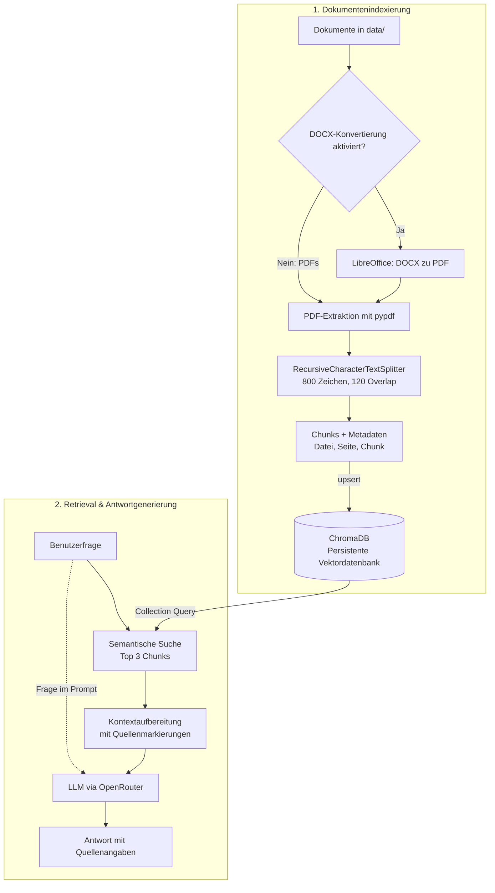

# RAG-Pipeline

Das Programm beantwortet Fragen zu Dokumenten aus `data/`. Es zerlegt PDFs in Textabschnitte, speichert sie in einer lokalen Chroma-Vektordatenbank und nutzt passende Abschnitte mit einem LLM über OpenRouter zur Antwortgenerierung. Antworten werden mit Quellenangaben ausgegeben.

## Ablauf



## Einrichtung

Voraussetzungen: Python 3.13 oder höher, `uv` und ein OpenRouter-API-Key.

```bash
uv sync
cp .env.example .env
```

Trage deinen API-Key in `.env` bei `OPENROUTER_API_KEY` ein.

## Bedienung

PDFs in `data/` ablegen und starten. Das Programm indexiert sie automatisch und beantwortet anschließend die vier eingebauten Beispielfragen:

```bash
uv run main.py
```

Optional DOCX-Dateien vor der Indexierung in PDFs konvertieren (benötigt LibreOffice als `libreoffice` im PATH):

```bash
uv run main.py --convert-pdf
```

Ohne dieses Flag werden nur vorhandene PDFs eingelesen.

Eigene Fragen eingeben:

```bash
uv run main.py --manual
```

Mit `exit` oder `quit` beenden. `--manual` und `--convert-pdf` lassen sich kombinieren.
